

# Hi, I'm David Israel García Alcázar 👋

### Lead Full-Stack Engineer · Staff-Level Technical Leader

I design resilient, accessible software and help distributed engineering teams turn complex requirements into dependable products.

## About me

I'm a software engineer and technical lead with **13+ years of experience** building and modernizing enterprise platforms across healthcare, real estate, physical security, publishing, finance, logistics, and government.

Today, I lead a distributed team of eight engineers at **Cohere Health**, delivering business-critical healthcare workflows for major U.S. health plans. I enjoy working where architecture, hands-on engineering, and mentorship meet: clarifying ambiguous problems, designing pragmatic systems, and helping teams ship with confidence.

- 🏗️ I work across the stack with **React, Angular, TypeScript, Java, Node.js, Spring Boot, GraphQL, and PostgreSQL**.
- 🤝 I lead through architecture guidance, thoughtful code review, delivery planning, and mentorship.
- ♿ I care about accessible interfaces, observability, resilient workflows, and maintainable systems.
- 🧠 I use AI-assisted engineering tools pragmatically, with secure review and validation as part of the workflow.
- ⚖️ Alongside engineering, I'm pursuing a **B.S. in Law**.

## Selected impact

| Area | Outcome |
| --- | --- |
| Healthcare at scale | Help support workflows serving approximately **40M patients**, **200K providers**, and 12 major healthcare organizations. |
| Platform reliability | Re-architected a reviewer-assignment system and improved resiliency and stability by **90%+**. |
| Product quality | Helped turn a high-defect workflow into one of the product's most stable areas, reducing defects to **fewer than six per quarter**. |
| Performance | Improved site load performance by **16%** through feature-flag architecture improvements. |
| Developer experience | Reduced Jest memory usage by **50%** and execution time by **35%**, lowering feedback time and CI cost. |
| Data visualization | Reduced rendering time for **20K+ map markers** from more than five minutes to about 20 seconds. |

## Technology toolbox

  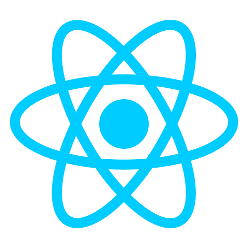
  &nbsp;
  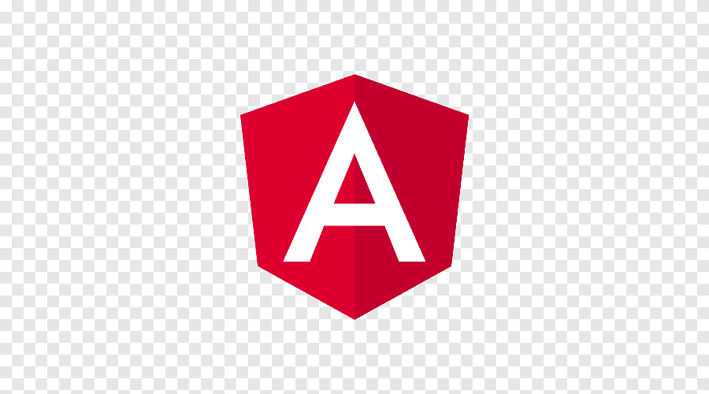
  &nbsp;
  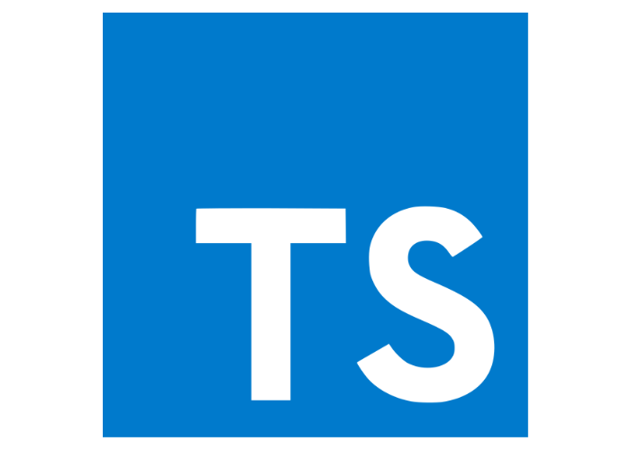
  &nbsp;
  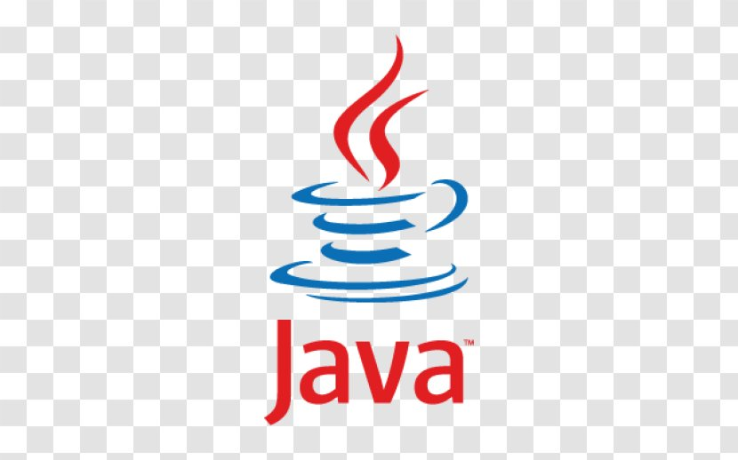
  &nbsp;
  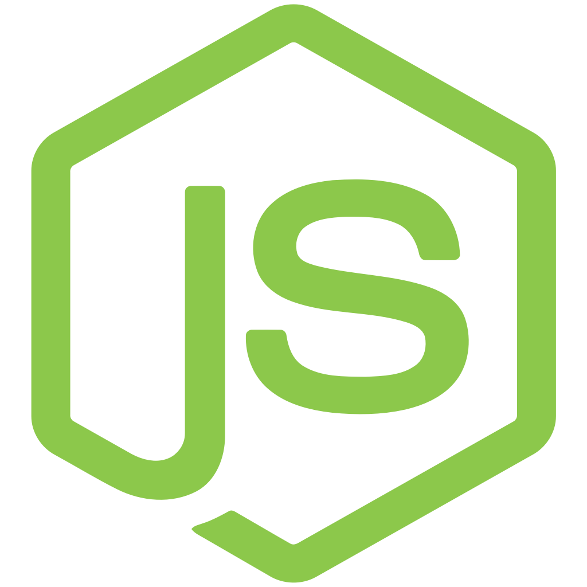
  &nbsp;
  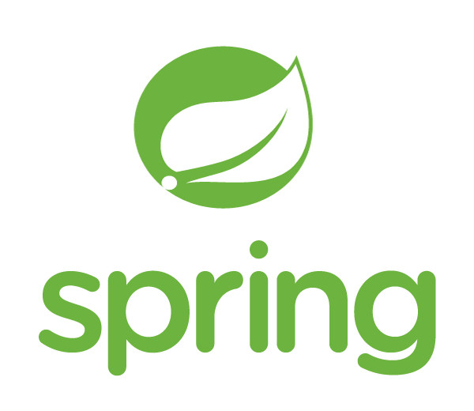
  &nbsp;
  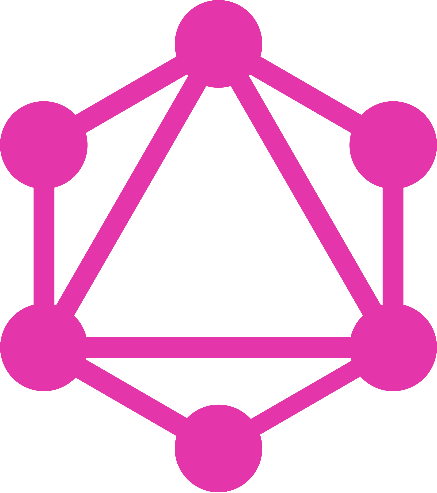
  &nbsp;
  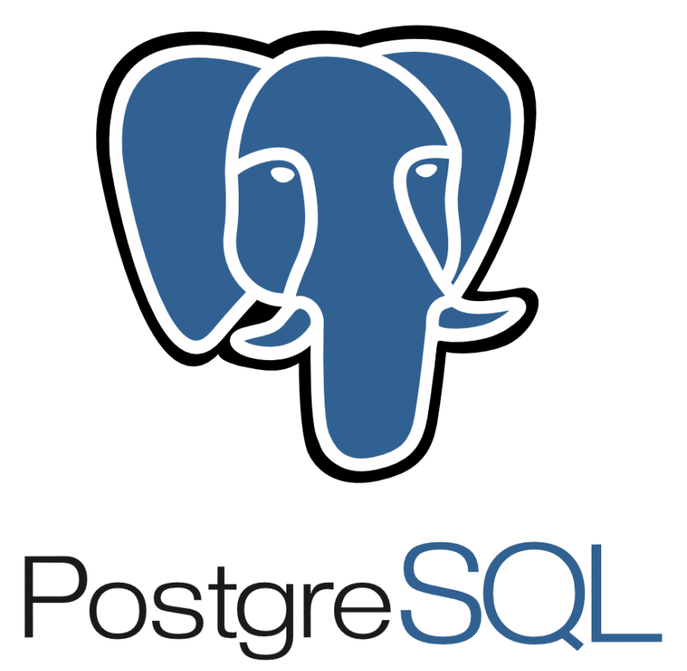
  &nbsp;
  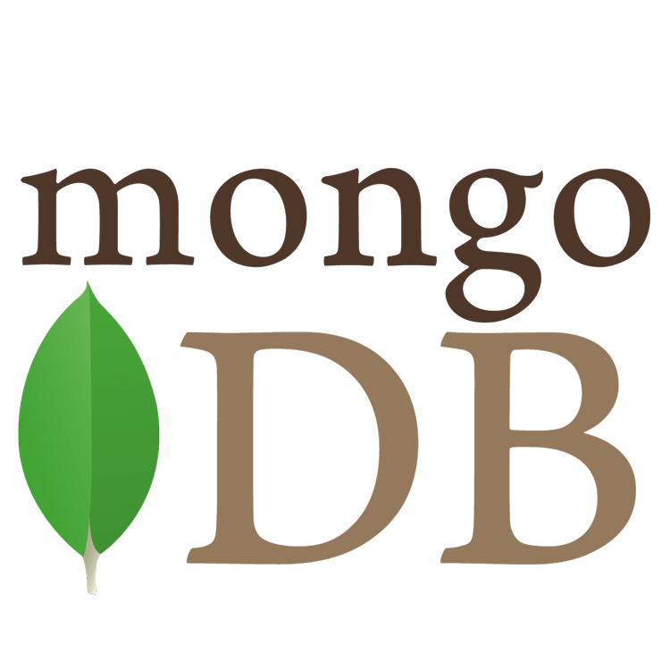
  &nbsp;
  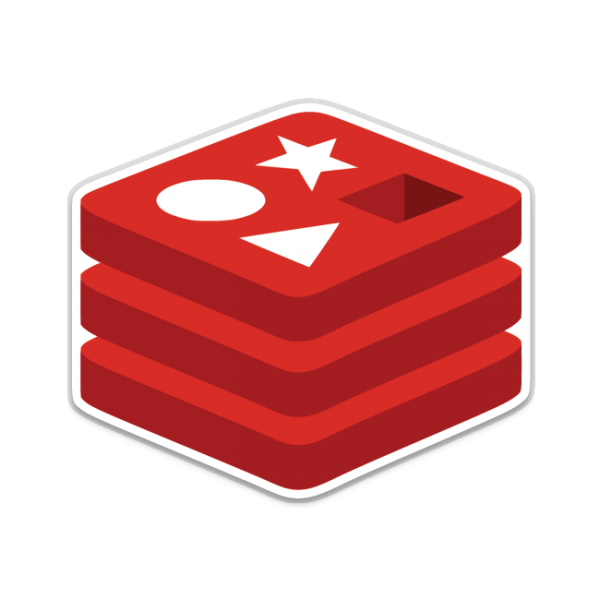
  &nbsp;
  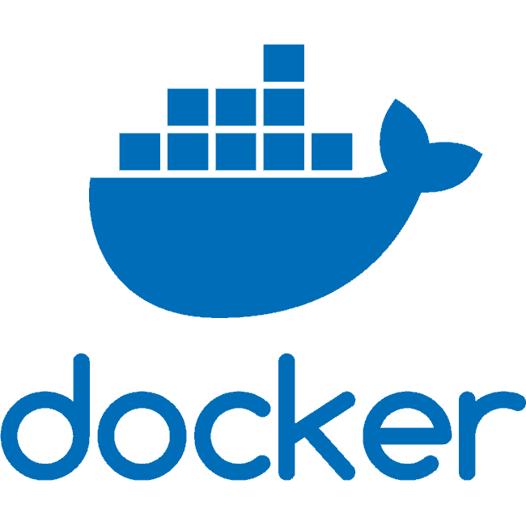
  &nbsp;
  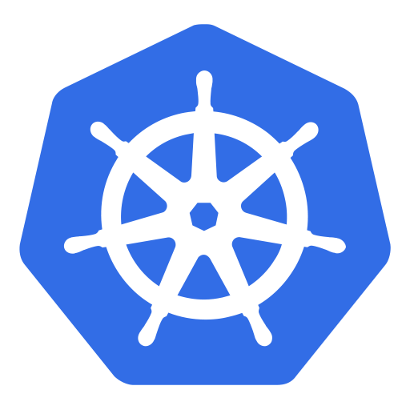

**Architecture & leadership:** system design, distributed systems, event-driven architecture, microservices, RFCs, technical roadmaps, mentoring, accessibility, reliability, observability, and CI/CD.

**Also experienced with:** AWS, Terraform/IaC, Kafka, Elasticsearch, MySQL, Python, C#, Vue.js, Jest, Cypress, GitHub Actions, Jenkins, Datadog, and Sentry.

## Experience snapshot

- **Lead Full-Stack Engineer · Cohere Health** — 2023 to present
- **Lead Full-Stack Engineer · AnthemIQ** — 2022 to 2023
- **Senior Full-Stack Engineer / Team Lead · Unosquare** — 2016 to 2022
- **Senior Software Engineer · UST Global** — 2016
- **Software Engineer / Technical Lead · INFOTEC** — 2015 to 2016

Earlier in my career, I built administrative and logistics systems, maintained business-critical infrastructure, and coordinated a small development team. Those years gave me a lasting appreciation for software that makes real work simpler.

## Beyond delivery

- Founded and led Unosquare's **Algorithms Guild**, growing it from 3 to 23 members.
- Competed in **ACM ICPC** and Mexico's **CONACUP** programming contests.
- Earned the **Oracle Certified Java Programmer** credential and completed coursework in AWS, Kubernetes/OpenShift, MongoDB, algorithms, and artificial intelligence.
- Presented technical talks and organized internal programming contests to make engineering knowledge easier to share.

## GitHub at a glance

[Explore my repositories →](https://github.com/idcodeoverflow?tab=repositories)

---

### Let's build something dependable.

I'm always glad to connect with people working on meaningful products, complex platforms, and healthy engineering teams.

